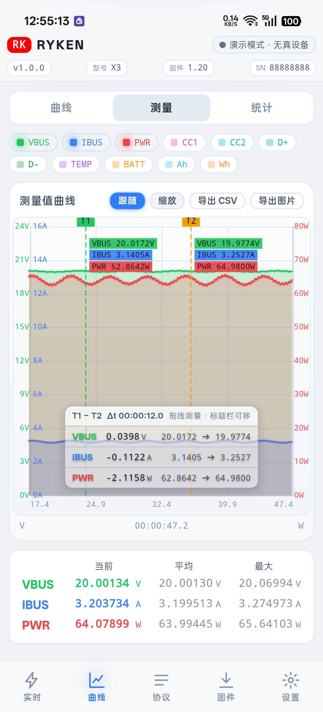
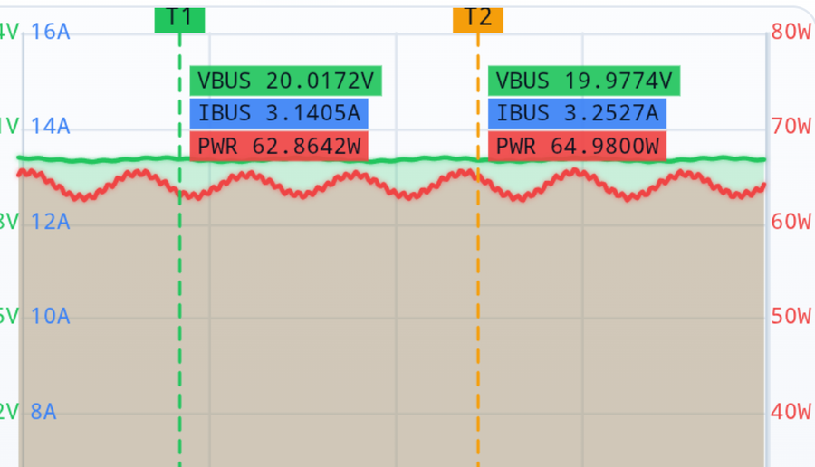
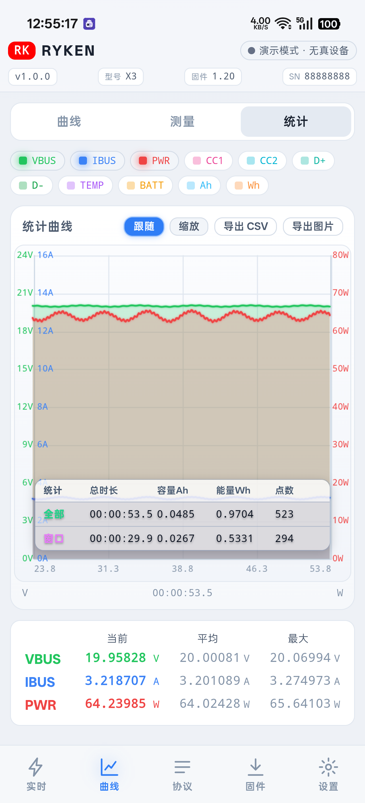
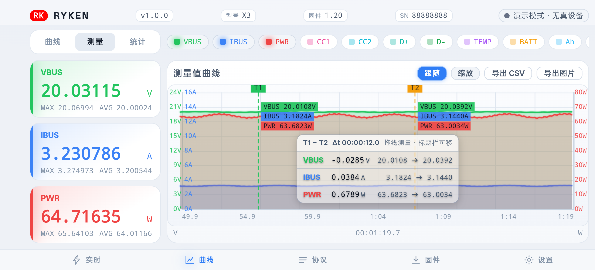

<div align="center">

# RYKEN Mobile

**瑞垦 RK-X3 / X3 SE USB 功率表 · 手机端上位机**

把官方 PC 版软件的能力搬到手机上：USB-OTG 直连功率表，实时曲线、协议解码、固件刷写全都有。

[](LICENSE)
[](#兼容设备)
[](CHANGELOG.md)
[](#技术栈)

**作者 [Biu-Bong](https://github.com/Biu-Bong)** · 以 MIT 协议开源

</div>

> [!WARNING]
> **非官方项目。** 本项目由第三方开发者独立实现，与瑞垦（RYKEN）官方**没有任何关联**，
> 未获其授权、认可或支持。`RYKEN` 及相关商标归其各自所有者所有。
> 本项目仅通过设备公开的 USB HID 接口与其通信，**不包含、不分发任何官方固件**。

---

## 目录

- [这是什么](#这是什么)
- [功能](#功能)
- [截图](#截图)
- [兼容设备](#兼容设备)
- [快速开始](#快速开始)
- [技术栈](#技术栈)
- [通信协议](#通信协议)
- [项目结构](#项目结构)
- [已知限制](#已知限制)
- [逆向分析报告](#逆向分析报告)
- [参与贡献](#参与贡献)
- [免责声明](#免责声明)
- [开源协议](#开源协议)

---

## 这是什么

[瑞垦 RK-X3](http://ryken.ysepan.com/) 是一款 2×24pin 直通的 USB 功率表，支持 QC / PD / UFCS /
SCP / FCP / AFC / SVOOC 等协议检测，配 16bit ADC 与 4MB Flash 离线存储。

官方只提供 PC 端上位机。**本项目是它的手机端替代实现**：手机通过 OTG 线直连功率表，
无需电脑即可实时看电压 / 电流 / 功率曲线、解码 PD 报文、写固件。

前端是一套纯 HTML/CSS/JS 的网页，被装进一个极简的 Android WebView 壳里。
**协议解析全部跑在 JS 侧**，因此修改协议或调整界面都不需要重新编译 APK。

## 功能

**实时测量**
- 主卡显示 VBUS / IBUS / PWR，副行显示 CC1 / CC2 / D+ / D− / 温度 / 手机电量 / 容量(Ah) / 能量(Wh)
- 容量与能量由上位机对采样值积分得出（设备本身不提供）
- 采样速率 1 / 10 / 50 / 100 SPS 可选，或「原生」全收（约 167 Hz）
- 数据缓存 100–1000 MB 可调（默认 100 MB ≈ 50 SPS 下约 6 小时）
- 支持触发条件自动停止记录

**曲线**
- 三种模式：**曲线**（浏览）、**测量**（T1/T2 两条可拖测量线，逐系列显示起止值与 Δt）、
  **统计**（全部 / 窗口 × 总时长 / 容量 / 能量 / 点数）
- 视图：跟随 / 缩放看全部 / 自由查看
- 测量窗与统计窗为悬浮在图表上的半透明浮层，可拖动、位置记忆、双击标题栏复位

**协议**
- PD 报文实时列表（GOODCRC 可过滤）、报文详情、UFCS 互斥提示

**固件**
- U 盘模式刷写（SAF 授权一次即可，无需 root）
- 检查更新支持**官方源 / 永硕云盘源 / 自定义**三档，永硕源原生直连并锁定根证书

**其它**
- 离线数据读取、开机图替换
- 主题（暗 / 亮 / 跟随系统，含 A 屏纯黑）、屏幕方向
- CSV / PNG 导出、运行日志与诊断

## 截图

| 测量（T1-T2 测量线） | 曲线特写（含 T1/T2 读数） |
| :---: | :---: |
|  |  |

| 统计 | 横屏 |
| :---: | :---: |
|  |  |

## 兼容设备

| 机型 | 支持 |
| --- | --- |
| RK-X3 | ✅ 已验证 |
| X3 SE | ✅ 已验证 |
| RK-X3 Pro | ✅ 已验证 |

**手机要求**：Android 7.0 (API 24) 及以上，支持 USB-OTG。
部分机型的 USB 控制器在热插拔后有概率卡死（见 [已知限制](#已知限制)）。

## 快速开始

### 方式一：直接安装 APK

到 [Releases](../../releases) 页面下载最新的 `RYKEN-Mobile-x.y.z.APK`，安装后插上功率表即可。
首次插入会弹出 USB 权限请求，勾选「默认用于此设备」可免去每次确认。

### 方式二：从源码构建

需要 **JDK 17** 与 **Android SDK (API 34 + build-tools 34.0.0)**。工程不依赖 AndroidX，
所以构建时几乎不需要联网下载额外依赖。

```bash
# 指向你自己的工具链（不设的话脚本里有作者机器的兜底路径）
export JAVA_HOME=/path/to/jdk-17
export ANDROID_HOME=/path/to/android-sdk

# Linux / macOS / Git Bash
bash android/build.sh

# Windows CMD
android\build.bat
```

产物路径：

```
android/app/build/outputs/apk/debug/RYKEN-Mobile-1.0.0.APK
```

> 构建前 `build.sh` / `build.bat` / Gradle 任务会自动把根目录的 `index.html` 与 `assets/`
> 同步进 `android/app/src/main/assets/www/`。**不要直接改 `www/` 里的文件**，改根目录的源文件。

### 方式三：免编译试用（PC 桥接）

不想装 App 可以先在电脑上跑起来，用手机浏览器访问：

```bash
python bridge.py                 # 默认监听 0.0.0.0:8765
# 手机浏览器打开 http://<电脑局域网IP>:8765
```

`bridge.py` 只用 Python 标准库，无需 `pip install`。它把手插在电脑上的功率表数据
通过 WebSocket 转发给手机浏览器，功能与 App 版一致（除固件刷写外）。

## 技术栈

- **浏览器端**：原生 ES Module + Canvas 自绘曲线，**零第三方库**
- **Android 壳**：Kotlin，**不引 AndroidX**，WebView 通过自定义 https 源加载本地资源
- **通信**：Android `UsbDeviceConnection` + `UsbRequest`（异步 URB）；PC 端 `bridge.py` 用
  `ctypes` 直接调 hidapi 风格的文件接口
- **协议解析**：全部在 `assets/js/ryken-protocol.js`，改协议不用重编 APK

## 通信协议

设备作为标准 HID 设备免驱接入（`VID 0x2E3C / PID 0xAF03`，UsagePage `0xFF00`），
输入 / 输出报告均为 65 字节（1 字节报告 ID + 64 字节负载）。

设备**完全被动**：必须由主机先发命令开启数据流。帧格式为：

```
AA | LEN | DATA | CRC16(BE)
```

- `LEN` = 整帧字节数（含 CRC 的 2 字节）
- CRC16：多项式 `0x2507`、初值 `0x11`、结果 `+1`、不反转位序
- 主要命令：`START`（开流，约 4.5 s 窗口）、`KEEPALIVE`（1 Hz 续期，断约 4.8 s 停流）、
  `INFO`（取设备信息帧）
- 测量帧以 `0x55` 为同步头，VBUS / IBUS 为大端 float32，D± / CC1 / CC2 为大端 uint16（单位 mV）
- 设备→主机的帧同样带 CRC16

更完整的帧结构、命令安全性逐条审计、以及固件内部实现分析，见
[逆向分析报告](#逆向分析报告)。

## 项目结构

```
.
├── index.html                 前端入口（WebView 加载）
├── assets/
│   ├── css/app.css            全部样式
│   └── js/
│       ├── app.js             主逻辑：页面、记录、导出、固件、设置
│       ├── chart.js           自绘曲线引擎（曲线 / 测量 / 统计）
│       ├── ryken-protocol.js  帧解析与 CRC（改协议只动这里）
│       ├── transport.js       USB ↔ JS 数据泵
│       └── demo.js            演示 / 离线模拟数据源
├── android/                   Android 壳
│   └── app/src/main/
│       ├── java/cn/ryken/mobile/
│       │   ├── MainActivity.kt     WebView 壳 + 自定义 https 源
│       │   ├── RykenUsb.kt         USB HID 收发（UsbRequest 异步 URB）
│       │   ├── RykenBridge.kt      JS ↔ 原生桥（window.Ryken）
│       │   └── KeepAliveService.kt 前台保活
│       └── assets/                 构建时自动同步的网页副本（勿手改）
├── bridge.py                  PC 端 WiFi 桥接服务（免依赖）
├── enum_hid.py                枚举 VID/PID
├── probe_caps.py              探测设备命令支持情况
├── probe_info.py              读取设备信息帧
├── probe_protocol.py          协议上报抓取
├── list_udisk.py              列出设备 U 盘内容
├── docs/                      逆向分析报告与截图
└── CHANGELOG.md               完整更新日志
```

## 已知限制

- **长时记录依赖屏幕常亮**：记录跑在 WebView 的 JS 泵上，息屏后系统会节流它。
  开启「记录中保持屏幕常亮」可连续记录；关闭则息屏约 8 分钟后会丢数据（App 会明确告警）。
- **X3 SE 的 USB 描述符没有产品名字符串**，机型靠固件版本段识别。
- **部分机型 USB 控制器偶发卡死**（如 ColorOS / Android 16 上的个别机型）：
  插表无反应时重启手机即可，不是 App 的问题。
- 离线记录与开机图**无法通过 HID 读取**（固件层面无此命令），只能走 U 盘模式。

## 逆向分析报告

`docs/` 下保存了本项目的逆向工作记录，也是协议实现的第一手依据：

| 文档 | 内容 |
| --- | --- |
| [`HID接口能力-取证报告.md`](docs/HID接口能力-取证报告.md) | 固件反汇编还原出的命令表、每一条命令的实际行为与安全性审计 |
| [`固件V2.00-解析报告.md`](docs/固件V2.00-解析报告.md) | U 盘资源结构、离线记录格式、开机图格式 |
| [`PD协议帧-解码笔记.md`](docs/PD协议帧-解码笔记.md) | PD 事件帧的字段布局与解码方法 |
| [`手机端自动刷机-可行性分析.md`](docs/手机端自动刷机-可行性分析.md) | IAP 模式进入条件与刷写通路分析 |

> 这些报告包含厂商固件的反汇编分析结果，仅供技术研究与互操作性参考。
> 其中记录了一条**会破坏设备固件的命令**并标注为危险 —— 请勿出于好奇尝试。

## 参与贡献

欢迎提 Issue 与 PR。提交前请注意：

- 前端改动只需改根目录的 `index.html` / `assets/`，**不要动 `android/app/src/main/assets/www/`**（自动生成）
- 涉及新的设备命令，请先在 `docs/HID接口能力-取证报告.md` 中核对它的安全性
- 提交日志请说明改动目的与验证方式（最好附实测截图）

## 免责声明

- 本软件按「原样」提供，不附带任何明示或暗示的担保。使用本软件（尤其是**固件刷写功能**）
  的风险由使用者自行承担，作者不对任何设备损坏、数据丢失或其它损失负责。
- 本项目**不包含、不分发**任何官方固件、官方 PC 软件或其提取资源。
- 「RYKEN」「瑞垦」等名称与商标归其各自权利人所有，本项目仅为第三方互操作性工具，
  与官方无关联、未获授权。
- 逆向分析仅出于**互操作性**目的，在合法持有设备的前提下进行。

## 开源协议

[MIT License](LICENSE) © 2026 [Biu-Bong](https://github.com/Biu-Bong)
